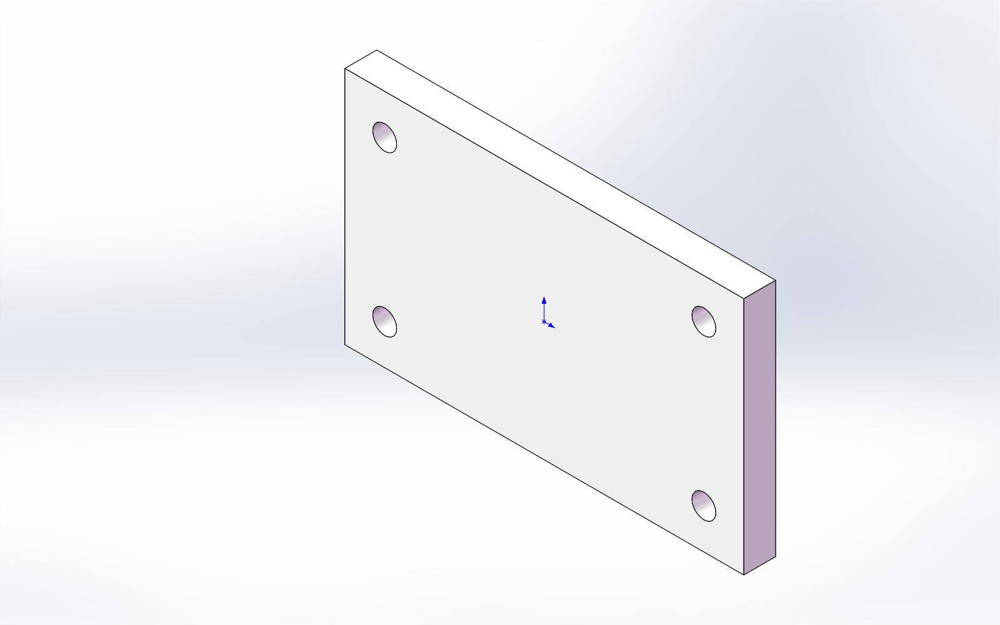

# SolidWorks ModelOps

面向 AI Agent 的 SolidWorks 建模、改尺寸与检查点恢复工具。基于上游 [SolidWorks Automation Skill](https://github.com/wzyn20051216/solidworks-automation-skill) 扩展，保留原有专项模块，在统一 JSON 入口中执行任务、读取实际几何、保存检查点并记录交付证据。

**当前版本为 v0.1 pilot。** 本版本的承诺范围是下表列出的统一入口。继承目录中出现的装配、工程图、曲面、仿真等模块，不代表这些能力都已纳入本版本的统一建模流程或完成本机验证。



该图来自真实 SolidWorks 回归样件；测试规格为 100×60×8 mm、四个 Ø6 通孔。

本次本机验证：**242 项离线测试通过、1 项跳过，4 题真实 CAD 回归通过**。
测试环境、预期失败的恢复语义和验证范围见 [验证记录](docs/VALIDATION.md)。

## v0.1 范围

| 操作 | 当前范围 |
| --- | --- |
| 创建零件 | 复用既有 `sketch_rectangle`、`sketch_circles`、`extrude_boss`、`extrude_cut` 四种动作及其参数、期望几何检查 |
| 修改尺寸 | 对源 `.SLDPRT` 的任务自有磁盘副本，按精确命名的线性尺寸修改；回读尺寸并检查重建与几何 |
| 检查点 | 将已验收状态保存成磁盘工件，记录文件 hash 和相应证据 |
| 恢复 | 验证检查点 hash，恢复到新的任务副本，重开并比较证据 |
| 回归 | 先离线验证 suite，再在已连接的本机 SolidWorks 中运行受限案例并生成报告 |

外部引用、配置族、装配修改，以及任意特征树编辑暂不属于 v0.1 的承诺范围。几何检查通过仍需结合模型用途复核，不能代替强度、寿命、公差、制造工艺或其他工程验证。

## 环境与安装

原生 `.SLDPRT` 建模、修改和恢复需要 **Windows、已安装并具有有效使用授权的 SolidWorks，以及同一交互桌面会话中的本地 Python/COM 访问**。先启动 SolidWorks，再运行原生任务。将文件上传到聊天窗口或仅加载 skill 文本，不会自动获得本机 CAD 控制能力。

建议使用 Python 3.11 或 3.12，在仓库根目录执行：

```powershell
python -m venv .venv
.\.venv\Scripts\Activate.ps1
python -m pip install -r requirements.txt
python scripts/sw_preflight.py --no-install
```

离线校验和单元测试不要求安装 SolidWorks。开发依赖可独立安装：

```powershell
python -m pip install -r requirements-dev.txt
```

AI Agent 使用说明见 [SKILL.md](SKILL.md)。上游专项能力与限制另见 [capabilities.yaml](capabilities.yaml) 和 [references](references/)；统一入口的范围以本文及实际请求校验结果为准。

下载本项目：

```powershell
git clone https://github.com/yangcody98-dot/solidworks-modelops.git
cd solidworks-modelops
```

要让 Codex 自动发现该技能，可将本仓库的技能文件放入自己的 skills 目录，文件夹名保留为 `solidworks-modelops`。
安装位置可使用 `~/.codex/skills/solidworks-modelops`；在客户端重新加载技能后调用 `$solidworks-modelops`。

## 统一 CLI

所有命令在仓库根目录执行。请求采用 JSON，使用显式尺寸、动作与验收条件；先 `validate`，再 `run`。输出目录应为新的任务目录。

### 创建

```powershell
python scripts/sw_modeling.py validate --request examples/modeling_create.json
python scripts/sw_modeling.py run --request examples/modeling_create.json --out-dir output/create-001
```

创建请求复用原有四动作计划。检查实际实体、体积、包围盒和特征状态；请求中的几何要求不能用“API 返回成功”代替。

### 检查源零件与修改尺寸

```powershell
python scripts/sw_modeling.py inspect --source "C:\CAD\source-part.SLDPRT"
python scripts/sw_modeling.py validate --request examples/modeling_edit.json
python scripts/sw_modeling.py run --request examples/modeling_edit.json --out-dir output/edit-001
```

`inspect` 只读取已经在 SolidWorks 中打开的零件，不自动打开或激活源文件。先在 SolidWorks 中打开要检查的源零件，再运行上面的命令。

`examples/modeling_edit.json` 中的源路径和尺寸名称是需要替换的示例。先检查实际源零件，再填写它已有的精确 `dimension@feature` 名称（不含文档名后缀）与目标值；不能直接把示例尺寸名称用于任意模型。任务对源文件的磁盘副本进行修改，未保存的源文档内存状态不等于磁盘副本。

### 列出检查点与恢复

```powershell
python scripts/sw_modeling.py checkpoints --root output/edit-001/checkpoints
python scripts/sw_modeling.py validate --request examples/modeling_restore.json
python scripts/sw_modeling.py run --request examples/modeling_restore.json --out-dir output/restore-001
```

恢复仍使用 `run`，请求中的 `mode` 为 `restore`。将恢复示例中的 `checkpoint_root` 替换为前一步真实生成的 `checkpoints` 目录的绝对路径，`checkpoint_id` 填入列出的检查点 ID。检查点是可核验的磁盘文件及元数据；恢复会核验 hash 并打开新副本，不以撤销栈或重新执行一段提示词冒充恢复。恢复成功与原任务全部完成分别报告。

## 回归与测试

回归 suite 将新建、编辑与恢复案例关联起来，避免手工填写示例中依赖前一步输出的路径：

```powershell
python scripts/sw_modeling_regression.py validate --suite examples/modeling_regression_suite.json
python scripts/sw_modeling_regression.py run --suite examples/modeling_regression_suite.json --out-dir output/regression-001
```

`validate` 只校验请求或 suite；原生 `run` 会使用本机 SolidWorks。运行报告、检查点和预览位于各自输出目录。请分别阅读任务结果、源文件保护结果与恢复证据；有检查点不表示每个计划步骤已经完成。

纯离线测试命令：

```powershell
python scripts/validate_skill.py
python -m pytest -q tests/test_sw_modeling.py tests/test_sw_modeling_regression.py tests/test_sw_checkpoints.py tests/test_sw_model_context.py tests/test_sw_plan_bridge.py tests/test_sw_closed_loop.py tests/test_sw_closed_loop_native.py
```

GitHub Actions 只运行明确列出的离线测试，不启动 SolidWorks，不执行 `tests/solidworks_*` 本机回归脚本。离线测试通过可证明被测请求、流程与保护逻辑的行为，不能证明任意 SolidWorks 版本上的 COM 建模成功。本仓库不预填尚未执行的测试通过数或跨版本兼容结论。

`apps/desktop` 及 CAD Studio 相关文档属于继承资料；依赖上游工作台前端、Tauri 或打包环境的 GUI 发布工具不包含在本技能包的发布清单中。

## 输出与保护约定

- 源文件、工作副本、导出、检查点与报告分开存放；已有源模型不作为写入目标。
- 关键写操作串行执行。每步依据实际读取结果决定继续、有限重试或停止。
- 检查点保留文件 hash 与对应状态。缺失、被修改或证据不足的检查点应停止恢复。
- 失败报告保留最后有效阶段、失败原因和恢复结果，便于人工审阅。
- CAD 文件、本地输出、缓存与个人配置默认不进入 Git；发布前按实际内容检查待提交文件。

## 来源与许可

采用 [MIT License](LICENSE)，保留上游版权与许可。继承范围及本轮新增说明见 [NOTICE.md](NOTICE.md)。本项目为独立社区工具，与 Dassault Systèmes SolidWorks Corporation 无隶属关系或官方背书。
