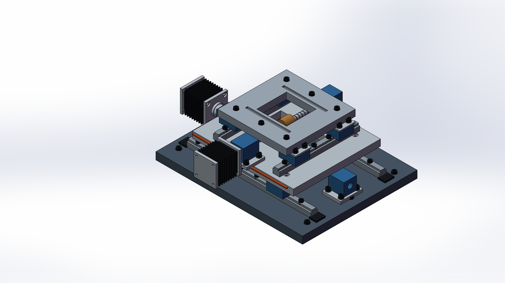

# SolidWorks ModelOps

Create parts, edit named dimensions, and recover verified checkpoints through one JSON interface for AI agents. Built on [SolidWorks Automation Skill](https://github.com/wzyn20051216/solidworks-automation-skill), ModelOps combines local CAD execution with measured acceptance checks and explicit delivery evidence.

**v0.1 pilot** · Windows + licensed SolidWorks for native operations · Source models stay read-only



*Independent 226-component XY positioning stage: generated as a colored STEP assembly with OCCT/OCP, imported and previewed in SolidWorks 2025. [Source, reproduction, and checks](docs/SHOWCASE.md). This static showcase is separate from the v0.1 unified executor's four-hole-plate benchmark.*

## Quick start

Use Python 3.11 or 3.12. Native `.SLDPRT` creation, editing, and recovery require Windows, an installed and licensed SolidWorks instance, and local Python/COM access in the same interactive desktop session. Start SolidWorks before running native tasks. Loading the skill text or uploading files to a chat does not grant local CAD access.

```powershell
git clone https://github.com/yangcody98-dot/solidworks-modelops.git
cd solidworks-modelops
python -m venv .venv
.\.venv\Scripts\Activate.ps1
python -m pip install -r requirements.txt
python scripts/sw_preflight.py --no-install
```

For Codex skill discovery, place the repository's skill files in `~/.codex/skills/solidworks-modelops`, reload skills in the client, and invoke `$solidworks-modelops`. Agent instructions are in [SKILL.md](SKILL.md).

Run all commands from the repository root. Requests specify dimensions, operations, and acceptance criteria. Validate first, then run into a new output directory.

### Create a part

```powershell
python scripts/sw_modeling.py validate --request examples/modeling_create.json
python scripts/sw_modeling.py run --request examples/modeling_create.json --out-dir output/create-001
```

The create request uses the existing four-operation plan. Acceptance checks use measured bodies, volume, bounds, and feature state; a successful API return alone does not satisfy the requested geometry.

### Inspect and edit dimensions

```powershell
python scripts/sw_modeling.py inspect --source "C:\CAD\source-part.SLDPRT"
python scripts/sw_modeling.py validate --request examples/modeling_edit.json
python scripts/sw_modeling.py run --request examples/modeling_edit.json --out-dir output/edit-001
```

Open the source part in SolidWorks before using `inspect`; inspection does not open or activate it. Replace the example source path and dimension name with the part's exact `dimension@feature` name, without a document suffix, and the requested value. Editing uses a disk copy of the source. Unsaved source changes must be saved before that snapshot is edited.

### List checkpoints and restore

```powershell
python scripts/sw_modeling.py checkpoints --root output/edit-001/checkpoints
python scripts/sw_modeling.py validate --request examples/modeling_restore.json
python scripts/sw_modeling.py run --request examples/modeling_restore.json --out-dir output/restore-001
```

Restore uses `run` with `mode: restore`. Set `checkpoint_root` to the absolute path of the generated `checkpoints` directory and `checkpoint_id` to a listed ID. Recovery verifies the saved file's hash, opens a new copy, and compares its evidence. Successful recovery and successful completion of the original task are reported separately.

## Scope

| Operation | v0.1 scope |
| --- | --- |
| Create | `sketch_rectangle`, `sketch_circles`, `extrude_boss`, and `extrude_cut`, with parameters and expected geometry |
| Edit | Precisely named linear driving dimensions in a task-owned copy of a source `.SLDPRT`; dimension readback, rebuild, and geometry checks |
| Checkpoint | Persist accepted states as disk artifacts with file hashes and supporting evidence |
| Restore | Verify checkpoint hashes, create a new task copy, reopen, and compare evidence |
| Regression | Validate the suite offline, then execute its bounded cases in local SolidWorks and record results |

Editing and recovery are limited to single-configuration parts without external dependencies. Configuration families, assembly editing, and arbitrary feature-tree edits are outside this release's scope. Geometry checks do not replace strength, life, tolerance, manufacturing, or other engineering validation.

Sources, working copies, exports, checkpoints, and reports remain separate. CAD writes run serially and target only task-owned documents. Each stage uses actual feedback to continue, retry within defined limits, or stop. Recovery stops when a checkpoint is missing, modified, or lacks sufficient evidence; failure reports retain the last valid stage and recovery result. CAD artifacts, local outputs, caches, and personal configuration are excluded from Git by default; inspect the actual files before publishing.

Inherited assembly, drawing, surfacing, and simulation modules are available as separate workflows with their own limits. Their presence does not establish support in the unified executor. See [capabilities.yaml](capabilities.yaml) and [references](references/). The inherited `apps/desktop` code and CAD Studio documents are retained for context; GUI release tools requiring the upstream frontend, Tauri, or packaging environment are excluded from this skill package.

## Validation

The recorded local run passed **242 offline tests, with 1 skipped, and all 4 native CAD regression cases**. The environment, expected-failure recovery semantics, and exact evidence scope are recorded in [VALIDATION.md](docs/VALIDATION.md).


*Actual SolidWorks regression fixture: 100 × 60 × 8 mm plate with four Ø6 through holes.*

The suite links its create, edit, and restore artifacts automatically:

```powershell
python scripts/sw_modeling_regression.py validate --suite examples/modeling_regression_suite.json
python scripts/sw_modeling_regression.py run --suite examples/modeling_regression_suite.json --out-dir output/regression-001
```

`validate` checks request or suite data only; native `run` uses local SolidWorks. Reports, checkpoints, and previews are stored in each output directory. Review task status, source protection, and recovery evidence separately. A saved checkpoint does not establish that all planned operations finished.

Offline validation and tests do not require SolidWorks:

```powershell
python -m pip install -r requirements-dev.txt
python scripts/validate_skill.py
python -m pytest -q tests/test_sw_modeling.py tests/test_sw_modeling_regression.py tests/test_sw_checkpoints.py tests/test_sw_model_context.py tests/test_sw_plan_bridge.py tests/test_sw_closed_loop.py tests/test_sw_closed_loop_native.py
```

GitHub Actions runs the explicit offline test set. It does not launch SolidWorks or execute the `tests/solidworks_*` live scripts. Offline results validate the tested request, workflow, and protection logic; they do not establish COM modeling compatibility across SolidWorks versions. Report only test results and version compatibility supported by actual runs.

## License

[MIT License](LICENSE). Upstream copyright and license notices are preserved; [NOTICE.md](NOTICE.md) identifies inherited work and the ModelOps additions. This is an independent community project, unaffiliated with and not endorsed by Dassault Systèmes SolidWorks Corporation.
