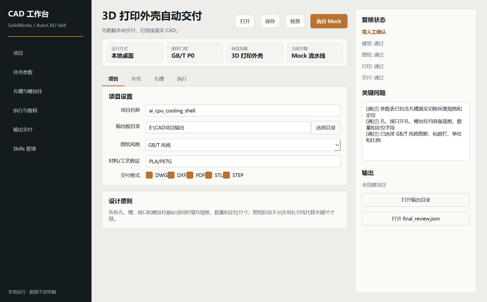

# CAD Automation Delivery Workbench prototype

This is the first local desktop prototype from `solidworks-automation-skill`.

This version demonstrates the user workflow:

```text
New project -> Enter parameters -> Save JSON -> Mock execution -> Review report and delivery directory
```

Native SolidWorks and AutoCAD automation is planned for a later version of this prototype's execution pipeline.



See `DESIGN.md` for interface rules. The visual direction is a calm engineering control room: drafting-paper surfaces, charcoal navigation, a single copper accent, and clear P0 review feedback.

## Install dependencies

```powershell
python -m pip install -r apps/desktop/requirements.txt
```

## Launch

```powershell
python apps/desktop/run.py
```

Or use the PowerShell launcher:

```powershell
powershell -ExecutionPolicy Bypass -File apps/desktop/start_desktop.ps1
```

## Build an executable

```powershell
powershell -ExecutionPolicy Bypass -File apps/desktop/build_exe.ps1
```

The packaged executable is written to:

```text
apps/desktop/dist/CADAutomationWorkbench/CADAutomationWorkbench.exe
```

## Current capabilities

- Create local project directories.
- Open projects and restore their parameter values.
- Edit parameters for 3D-printed enclosures.
- Edit structured tables of holes, interface cutouts, and screw bosses.
- Run parameter-completeness checks independently.
- Write `project.json` and `parameters.json`.
- Generate mock models, drawings, review reports, `manifest.json`, and delivery notes.
- Display P0 rule-check results.
- Navigate between key workflows and open the output directory or skill repository.

## Current limitations

- This prototype does not call SolidWorks COM.
- This prototype does not call AutoCAD COM.
- Generated CAD files are mock placeholders and cannot be used for manufacturing.
- P0 checks cover parameter completeness and file structure; real model and drawing review is planned.
