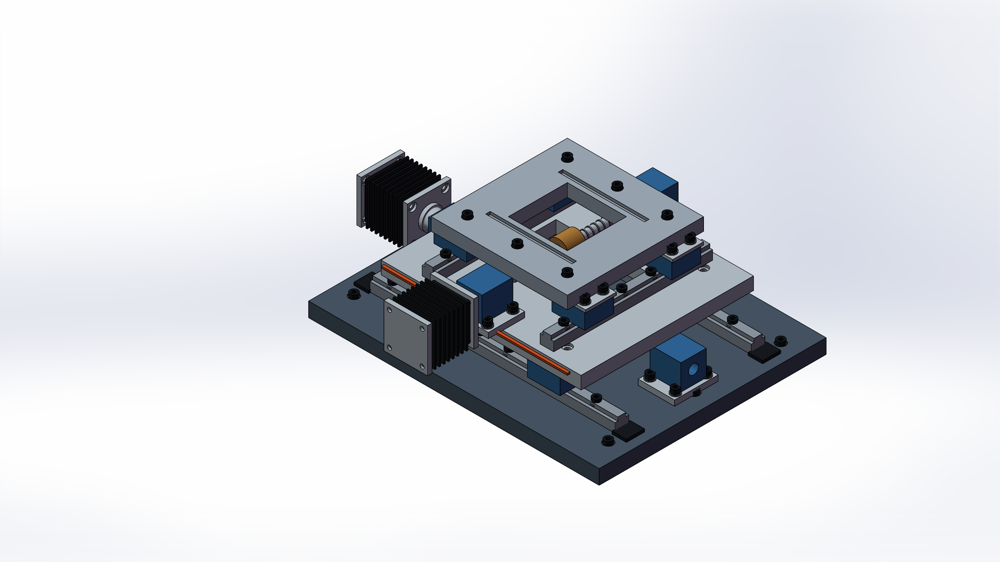

# Independent XY-stage assembly showcase



The homepage image is a genuine SolidWorks shaded-with-edges preview of a standalone demonstration assembly. It shows two guide-rail stages, eight slider blocks, drive-shaft and bearing envelopes, two generic finned motors, three structural plates, and socket fasteners. It was created specifically for this repository and does not contain an existing project or a supplier's CAD model.

## Provenance

| Item | Recorded value |
| --- | --- |
| Date | 2026-11-11 |
| Geometry source | [09_xy_stage_visual_demo.py](../examples/09_xy_stage_visual_demo.py), OCCT/OCP primitives and boolean operations |
| Exchange format | Colored, named STEP assembly |
| Component instances | 226, from 21 checked prototypes |
| Preview application | SolidWorks 2025 SP2.0, revision 33.2.0 |
| Homepage image | 2560 × 1440 PNG, converted directly from SolidWorks `SaveBMP` output |
| Evidence | [Sanitized machine-readable record](validation/2026-11-11-showcase.json) |

The image was not generated by an image model. The STEP import contains geometry rather than a native parametric feature history. This example demonstrates a reproducible assembly visualization workflow; it does not add arbitrary assembly creation or editing to the ModelOps v0.1 unified JSON executor.

## Reproduce

Run these commands from the repository root, in the same interactive Windows desktop session as a running, licensed SolidWorks instance:

```powershell
python -m pip install -r requirements.txt -r requirements-occt.txt Pillow
python examples/09_xy_stage_visual_demo.py --out-dir output/xy-stage-demo-001
```

Use a new output directory each time. The script writes the STEP assembly, a geometry report, four standard review views, a native BMP hero export, a PNG encoding of that export, and a SolidWorks preview report. SolidWorks may also create import-support files in this task directory. Local reports can contain absolute paths; the public record linked above omits those paths.

To generate the STEP file and geometry report without importing into SolidWorks:

```powershell
python -m pip install -r requirements-occt.txt
python examples/09_xy_stage_visual_demo.py --out-dir output/xy-stage-step-001 --step-only
```

`--step-only` does not require SolidWorks or the Windows COM packages. Rendering additionally needs the regular Windows dependencies and Pillow. View appearance can vary with SolidWorks version, import settings, and display configuration. A regenerated STEP file may contain different header timestamps, so compare measured checks rather than expecting its file hash to match this recorded run.

## Recorded checks and limits

All 21 source prototypes passed OCCT shape-validity checks and had positive finite volume. SolidWorks imported 226 components, and per-component appearance readback matched the assigned palette. The review and hero export produced nonblank previews and found the expected STEP output. The original active document's COM identity, captured state, and the SolidWorks working directory matched their pre-run values after cleanup.

A second real import deliberately supplied an incorrect expected component count of 225. It failed at the count check and still restored the original active document identity, captured state, and working directory. This checks one failure path; it does not establish recovery from every possible COM or application failure.

Assembly-wide geometry measurements were unavailable through the part-oriented review helper. No assembly mates, interference, fits, travel, motion, strength, life, or manufacturing checks were performed. The grooved shafts, motors, bearings, and other purchased-component envelopes are illustrative, not supplier specifications. This static showcase is separate from the [four-case native part regression](VALIDATION.md); it is not a production-ready machine design.
